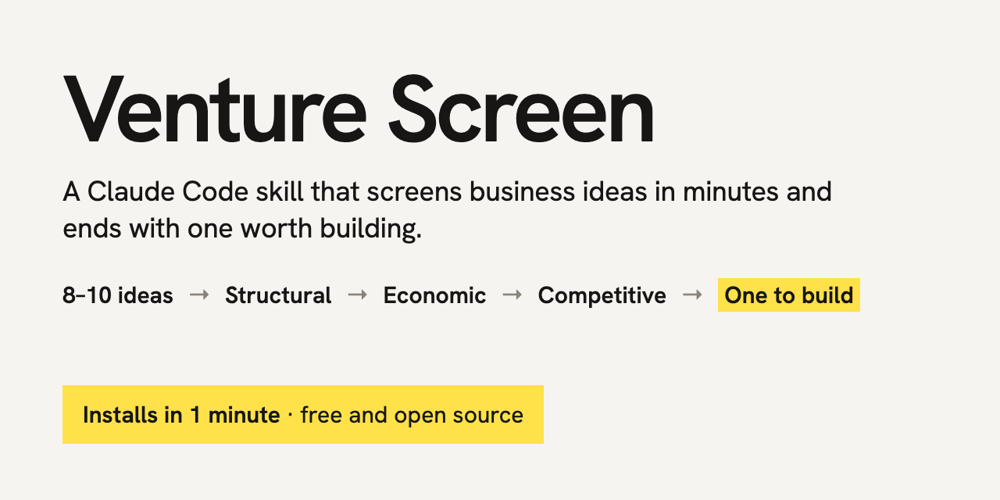

# Venture Screen for Claude Code

A Claude Code skill that helps you pick a business idea worth building, without wasting days on ideas that were dead from the first message.

Most idea sessions with an AI go wrong in one of two ways. Either it writes a 20-page plan for an idea that a five-minute check would have killed, or it kills every idea because "someone already does this". Venture Screen fixes both:

- **Cheap checks first.** Three gates (structural, economic, competitive) run in minutes, before anything longer than a page gets written.
- **A way to say yes.** Survivors are scored on six signs an idea is worth your next six months, and competition counts as a headwind, not a verdict.
- **Better inputs.** Every batch of 8–10 ideas comes from at least three kinds of source, not just desk research.
- **Never empty-handed.** Every session ends with a ranked list, one recommendation, and the cheapest test of it.

It starts by asking about you (money, team, network, constraints), because an idea is only good or bad for someone.

## Install

You need [Claude Code](https://claude.com/product/claude-code). Paste this into it:

```
Install the Venture Screen skill from https://github.com/theonlyalexmorningstar/venture-screen: copy its skills/venture-screen folder into ~/.claude/skills/.
```

Or in a terminal:

```bash
git clone https://github.com/theonlyalexmorningstar/venture-screen && mkdir -p ~/.claude/skills && cp -r venture-screen/skills/venture-screen ~/.claude/skills/
```

Then start a new Claude Code session and say *"Find me a business idea worth building"*, *"Screen this idea: …"*, or type `/venture-screen`.

Optional: keep a `founder-profile.md` (your assets, gaps and constraints) and a killed-ideas file in your project, and the skill will read them instead of asking every time.

## Licence

MIT, © 2026 Alex Andronov. See `LICENSE`. Questions or results worth sharing: message [Alex Andronov](https://www.linkedin.com/in/alex-andronov) on LinkedIn.
